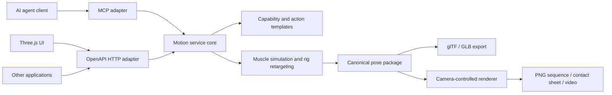

# 跨项目人体动作协议：方案与优先级

状态：MVP 已实现 v1 只读目录与同步求解接口（见文末「实现状态」）；GLB 已作为派生导出实现（工作台按钮 + Node CLI，非服务端输出格式），渲染请求、MCP 适配与异步任务尚未实现。此方案根据三轮独立脑暴与评审整理，目标是让项目通过经过校验的数据参数请求已支持的动作，避免为每次动作请求临时写代码或让 LLM 生成代码。

## 结论与排序

| 优先级 | 方案 | 解决的问题 | MVP 选择 |
|---|---|---|---|
| 1 | 固定版本的动作能力目录与姿态数据契约 | 不同项目对动作参数、骨架、坐标和姿态的解释不一致 | 先支持一个明确 rig 和一个动作；JSON Schema 校验参数，返回可检查的 JSON 姿态包与质量 / 来源清单 |
| 2 | 声明式动作模板与有限动作组合 | 不让每个动作都变成一段新求解器代码 | 动作由已验证的阶段、任务曲线、末端目标和约束原语组成；新动作只使用目录里已有的原语，超出能力就明确报错 |
| 3 | HTTP API 为主、MCP 薄适配；动画与渲染分层 | 普通项目和 AI agent 都能调用，并能按受众选择 3D 或 2D 结果 | OpenAPI 描述 HTTP 接口；MCP 将相同操作映射为 tools/resources；先同步运行，测出延迟后再决定是否加入任务队列 |

默认应返回动作本身的机器可读姿态数据，而不是只返回某个角度的一张图。3D 项目可以播放、重定向或重新布景；需要 2D 素材的项目再请求固定相机渲染。渲染是同一动作结果的视图，改变相机不应重新求解动作，也不应改变骨骼轨迹。

## 当前项目边界

当前工作区有 Vite / Three.js 浏览器界面，以及离线 Python / MuJoCo 肌肉动作生成与记录脚本；扫描未发现可供其它项目调用的常驻 HTTP 后端或 MCP server。因此需要增加一个单体计算服务和薄协议适配层，不能把当前页面地址视作已有动作 API。优先复用 Python 求解器与动作模板；TypeScript 前端和其它客户端都通过同一份接口描述调用它，避免另建微服务。



## 第一优先：动作能力目录与姿态契约

每个动作有不可变的 `actionId + revision`，一份 action-specific JSON Schema 描述参数类型、单位、默认值、范围、兼容 rig 和支持的输出。`handedness` 表示角色的解剖学左 / 右侧；`durationScale` 仅在动作支持时表示所有阶段时长的统一倍率。第一版不提供语义不清的全局 `intensity`；如果某动作确实支持幅度或用力等级，必须在该动作自己的 schema 里定义其对任务幅度或肌肉激励的确切影响。

动作请求参数是经过限制的语义参数，不是任意骨骼角度、肌肉激活数组、脚本或文件路径。执行前检查动作版本、参数范围、目标 rig、所需关节、可达性和输出格式。能力目录只列出真实可执行的动作 / 约束组合，不把“将来可能支持”写成当前能力。

姿态包使用可读 JSON 作为 MVP 的规范数据，GLB / VRMA / 图片从该规范姿态派生。第一版不新造 `poses.bin` codec；限制动作时长、关节数和采样数并测量压缩后体积 / 解析时间。只有当这些实测指标成为实际瓶颈时，才定义版本化二进制编码和参考解码器。

规范字段至少固定为：

- `schemaVersion`、动作 ID / revision、实际采用的参数、求解器与模型版本、请求指纹和来源记录。
- 目标 rig ID / revision，以及拓扑、rest pose、语义骨骼映射和网格资源各自的版本 / 哈希。哈希算法与规范化输入必须在格式规范中固定；包内附完整骨架描述，不能只给一个无法解释的 hash。
- 坐标按右手系，米、弧度、四元数 `[x,y,z,w]`。协议明确角色朝向约定，例如角色局部 `+Z` 向前；不把角色朝向与 glTF 摄像机沿局部 `-Z` 观察的方向混为一谈。
- 每根骨骼有稳定 ID、父 ID、局部轴与 rest-local TRS。首版姿态的 `poseMode` 固定为相对父节点的绝对 local TRS；未输出的关节沿用 rig 清单中的 rest TRS。非根骨骼默认不动画 scale。
- 每帧时间戳以动作开始为零、单位秒，时间戳列表是唯一时间真值；不再同时给出可能互相矛盾的 `fps` 与帧时间。时间轴最后一项恒等于动作时长（`duration×fps` 非整数时末段区间可以不足 1/fps）。平移线性插值，旋转使用归一化的最短弧 SLERP。事件时间也用动作相对秒数。
- 根运动轨迹在角色局部坐标里；调用者的世界位置和朝向是独立的 `placement`。固定原地动作标明 `inPlace`，不暗示存在跨步或位移。
- `quality` 按状态、警告代码和可操作的测量值表达，例如“精确 rig 匹配 / 已重定向 / 拒绝”，末端误差、被省略的手指轨道、不可达目标或关节限位残差。不用单一分数掩盖失败条件。

示意请求：

```json
{
  "schemaVersion": "1.0",
  "action": { "id": "baseball-throw", "revision": "1.0.0", "parameters": {} },
  "targetRig": { "id": "makehuman-body", "revision": "1", "topologyHash": "…", "restPoseHash": "…", "semanticMapHash": "…" },
  "placement": { "translationM": [0, 0, 0], "rotationXYZW": [0, 0, 0, 1] },
  "outputs": [{ "kind": "motion", "format": "pose-json" }]
}
```

这是接口形状示意，不代表当前动作已经可通过 API 请求。特定动作若不能换左手或目标 rig 缺少所需关节，目录应拒绝该组合并返回缺失项。准确 rig 可直接输出；经验证的重定向适配器可转换到另一个 rig，并逐项报告重定向或限制结果；禁止只看骨骼名字就宣称“任意 humanoid 通用”。

来源清单要分开记录动作数据 / 研究依据、人体 rig、皮肤网格、渲染素材及其许可和派生方式。一个动作资源的许可不自动覆盖模型或渲染图。当前仓库使用的 CMU 动捕转换文件和 MakeHuman 网格是不同来源，不能互相继承许可声明。

## 第二优先：可复用、无需生成代码的动作模板

动作模板以阶段和已注册的控制原语描述运动意图，例如准备、加载、骨盆驱动、躯干跟进、末端加速、随挥；阶段可包含经过验证的关节 / 末端任务曲线、根轨迹、接触事件和关节 / 支撑约束。运行时仍由动力学引擎决定实际姿态，模板任务不是把最终关节角直接当作物理结果播放。

新变体可通过动作已有的参数更改侧别、节奏、站姿或目标位置。后续若验证有价值，可允许一段由已固定版本模板组成的有限序列和少数命名过渡；每段需要明示时长、过渡方式和接触状态。第一版不做任意分支、通用动作语言、任意肌肉编排或自由物理约束。若动作依赖目录里不存在的触地切换、新肌肉控制律或器材接触，增加求解器能力仍需要工程工作。

这样可以把 LLM 从执行链路移除：普通程序直接提交 action ID 和 JSON 参数；LLM 仅可选地把自然语言翻译成候选 action / 参数，再由同一个 schema 验证。没有对应模板时返回可用动作和缺少的能力，不生成未经验证的动作代码。

## 第三优先：调用接口与渲染分层

建议的最小 HTTP 接口：

| 操作 | 作用 |
|---|---|
| `GET /v1/capabilities` | 列出服务版本、动作、rig、参数 schema、输出类型与资源上限 |
| `GET /v1/actions/{actionId}` | 返回单个版本动作的参数定义、来源和可执行约束 |
| `GET /v1/rigs/{rigId}` | 返回骨架、rest pose、局部轴、映射与指纹 |
| `POST /v1/motions` | 提交动作参数和目标 rig；短任务同步返回姿态包，重复请求使用独立的 `Idempotency-Key` |
| `GET /v1/motions/{motionId}` | 仅在任务超过同步时限并返回 `202` 时用于查询状态和结果 |
| `POST /v1/motions/{motionId}/renders` | 为已有 motion 生成指定相机、时间点 / 阶段和风格的图片或视频 |

请求内容的规范化哈希用于识别输入相同与否；幂等键只用于把客户端重试关联到同一次运行。两者分开定义。结果需记录动作、rig、solver、模型、资源哈希和完全解析后的默认参数。只有在钉住软件 / 数据版本并完成重复运行测试后，才声明可重复；GPU 渲染通常应定义平台和误差容限，不能承诺跨设备逐像素一致。

如果动作求解在测量后超过约定的同步响应时限，`POST` 返回同一 motion 资源的 `202` 和查询位置；否则返回完成的资源。不要为短动作提前引入任务队列、缓存服务或多服务编排。开始时限制动作时长、帧数、并发、分辨率和存储；本地部署只监听 loopback 并限制来源，不接受用户提供的脚本、路径或任意模型文件。

普通程序接口以 OpenAPI 描述，便于其它语言发现和生成客户端；AI agent 可选用 MCP adapter，把同一服务映射为 `list_capabilities`、`get_action`、`run_motion`、`get_motion`、`render_motion` 等 tools。MCP 本身面向 AI 应用的工具 / 资源连接，因此是补充入口，不应代替普通项目的 HTTP API。两层共享动作 schema 和服务核心，避免维护两套参数定义。

## 图片、动画文件与相机参数

当接收方明确是 3D runtime / DCC：先交付规范 pose JSON 与清单；再提供绑定到声明 rig 的 GLB 动画。GLB 兼容性好，但绑定了具体节点骨架，并不自动代表可重定向到所有人体骨架。VRMA 只对通过验证的 VRM 目标提供。glTF 规范了 node hierarchy、动画 sampler/channel、时间和插值等传输结构；它没有替本项目定义动作语义和通用人体映射，因此骨架映射、相位事件和质量数据保留在本协议清单中。

当接收方明确需要 2D：另行请求固定时间或时间区间的 PNG 序列，附每帧时序和 render manifest；contact sheet 用于快速审阅，sprite atlas 额外附格子尺寸、帧顺序、pivot 与裁剪偏移，WebM / MP4 用于审阅或播放。单张图和视频是视角固定的像素，不保留骨骼可编辑性，不能替代动作数据。

RenderRequest 独立引用一个已完成的 motion，可包含命名相机预设或数值相机：位置、look-at、up、透视 / 正交投影、视场 / 尺寸、构图、分辨率、时间范围 / 采样率、背景、透明度、alpha 约定、色彩空间与一个有版本号的风格预设。`front / side / back / threeQuarter / handCloseup` 等预设必须解析成固定相机参数并回写到 manifest。角色朝向与相机朝向分别命名；任何相机字段都不能修改 pose 输出。

漫画化或透明底图可以是用户显式选择的可选 render preset，但需固定 renderer、风格版本和素材许可。第一版不接受无限制自然语言风格，也不默认生成所有相机角度、全帧图片或视频，以免数据和算力暴涨。没有指定下游类型时，默认给姿态数据和小型关键帧预览；不自动输出整段视频。

## 分阶段验收建议

1. 写出 JSON Schema、骨架清单示例、OpenAPI 草案和一个完整动作包；冻结时间、坐标、local TRS、根运动、哈希和错误码语义。
2. 选一条当前确实支持的动作与目标 rig，从模板到 JSON 姿态包完成端到端校验；提供解析器 / validator 和黄金 fixture，独立重算 FK 并复查关节范围、骨长、相位连续性和质量指标。
3. 用同一姿态数据导出 GLB，验证目标 Three.js 与至少一个独立客户端能播放；第二个 rig 只有在适配器通过映射和误差测试后才列为支持。
4. 通过相机 render 请求做静帧和阶段 contact sheet，固定渲染参数；之后再按明确消费需求添加 alpha 序列、atlas、风格预设和视频。
5. 基准测量完成时延、P95、姿态包大小和渲染耗时，再决定是否增加 `202` 任务状态、取消、缓存或二进制格式。

## 主要风险与明确边界

- 参数化模板可以消除重复编写常见动作的代码，但不能凭参数创造尚不存在的肌肉控制原语、关节自由度、接触约束或求解器能力。
- 运动参考、工程任务曲线和物理求解响应必须分别标注。质量报告是对该模板、rig 和求解器的具体检查，不代表普遍生物力学有效性。
- rig hash 不可替代 rig descriptor；重定向报告也不等于真人动作精度。手指、root-motion、接触等每类能力都需要可检查的明确状态。
- 输出许可按姿态、源动捕、骨架、网格和像素素材分别记录。渲染图许可不能由动作来源许可推断。
- 可重复计算需要完整固定动作 revision、模型、solver、rig、renderer 和参数。不同 GPU / driver 的像素结果允许有误差，必须单独说明。

## 参考标准

- [Khronos glTF 2.0 规范](https://registry.khronos.org/glTF/specs/2.0/glTF-2.0.html)：节点层级、骨架 skin、动画输入时间、采样器和通道；glTF/GLB 作为动画载体与导出格式。
- [VRMC_vrm humanoid 规范](https://github.com/vrm-c/vrm-specification/blob/master/specification/VRMC_vrm-1.0/humanoid.md)：将人体语义骨骼映射到 glTF 节点，适合作为可选 VRM adapter，不作为所有客户必须使用的唯一骨架。
- [OpenAPI 规范](https://spec.openapis.org/oas/latest.html)：面向普通 HTTP 客户端的语言无关接口描述，可用于能力发现、schema 发布和客户端生成。
- [MCP 规范](https://modelcontextprotocol.io/specification/2026-07-28)：定义 AI 应用连接工具和资源的协议，支持可选 agent adapter；其官方边界是 AI 应用生态，不替代通用项目 API。

## 实现状态（MVP v1）

已实现：`apps/server/`（`@human3d/server`）单体服务（`npm run service`，仅 loopback，`node:http` 零新增运行时依赖）+ `spec/` 契约文件；工作台侧浏览器构建器 `packages/motion-core/src/package-export.ts`（`POST /v1/motions` 对等，字节级钉死）+ 姿态包/GLB 导出入口；实验室 `openPosePackage` 经 `posePackageSpec` 派生回放 spec（信封/ad-hoc presentation 通道）。

| 端点 | 状态 |
|---|---|
| `GET /v1/capabilities` | ✅ 服务版本、动作目录（含参数 schema、来源、缺陷 notes）、rig 摘要、资源上限 |
| `GET /v1/actions/{id}` | ✅ 单动作描述 |
| `GET /v1/rigs/{id}` | ✅ rig manifest：163 骨拓扑、rest local TRS（平移=父子 head 差、旋转恒等）、VRM humanoid 语义映射（52 骨映射 / 111 extra）、manifestSHA256 + sourceSHA256 |
| `POST /v1/motions` | ✅ 同步返回 pose-json；`Idempotency-Key` 重放 / 冲突 409（上限 256 键 / 15 分钟 TTL）；请求体支持 `Content-Encoding: gzip`（上限按解压后计）；`provenance.requestFingerprint` = 排序键 canonical JSON SHA-256（RFC 8785 JCS 待替换），包 `id` = artifact 身份（请求指纹 + 定义哈希 + rig manifest 哈希 + solver 版本联合哈希，求解器/骨架升级即变） |
| `GET /v1/motions/{id}` | ❌ 未实现——当前全部同步完成，无异步任务 |
| GLB 导出 | ⚠️ 部分实现——派生导出已落地（工作台「导出 GLB」+ `npm run package-to-glb`，共享 `packages/motion-core/src/glb-export.ts`；包时间轴原样入 clip，逐骨四元数 + root 位移轨）；服务端 `outputs.format:'glb'` 有意未做——GLB 是派生品不是交付格式，渲染分层属后置阶段 |
| `POST .../renders`、VRMA 导出、MCP adapter | ❌ 未实现——按分阶段验收顺序后置 |

目录诚实的边界：五个内置动作（idle/reach/squat/ready/forehand——`assets/motions/*.json` 的 `workshop-motion` 信封，内嵌规范化 WorkshopDoc，与服务端同一条求解管线）+ `workshop-doc`（提交校验过的 WorkshopDoc，≤10s/120 keys，参数即模板原语——对应第二优先的声明式模板雏形）。`walk`（CMU 动捕转换，`clip-motion` 信封指向外部片段，轨迹不进姿态管线，许可边界）、动力学动作（`punch`/`baseball-throw`，`dynamics-motion` 信封进文件注册表即网页动作库，但离线分钟级求解、需要记录回放→姿态包转换，按 `service.ts` 的 kind 过滤不进服务目录）均不在目录中；`shotput`/`throw` 无对应资产。信封 `notes` 原样进入目录 notes 与 `quality.warnings`（如 forehand 的 `research-reference` 研究参考声明）。

姿态包约定：仅输出非恒等旋转轨道 + root 平移（共享时间戳网格）、四元数半球连续化、事件（phase/keyframe/contact + 支撑区间事件 support-start/support-end，仅在 false↔true 转换处各发一次）、quality（膝/肘/肩限位与足底高度逐帧聚合 + workshop 逐关键帧约束检查 + warnings）。`action.definitionSHA256` 哈希的是解析后的真实动作定义（内置动作为 `motionDefinitionPayload`：规范化 document + phases + notes + license；`workshop-doc` 为规范化文档），不是动作名。`packages/motion-core/src/validate.ts` 是独立校验器（不共用求解代码），重算 FK 复查段长、范数、半球连续、时间戳；`spec/examples/idle.pose.json` 是黄金 fixture（`npm run protocol:example` 重新生成）。

验证发现并已并入设计的修正：OpenAPI 锁 3.1（对齐本仓既有 draft-2020-12 schema）；语义表采用 VRM humanoid 词表而非自造命名；MuscleMimic/MyoSuite 消费的是特定 MuJoCo 骨架的 qpos 轨迹——TRS 姿态包是呈现/交付格式，未来可加 solver-native `qpos/qvel` 块而非把 TRS 当求解器输入。
