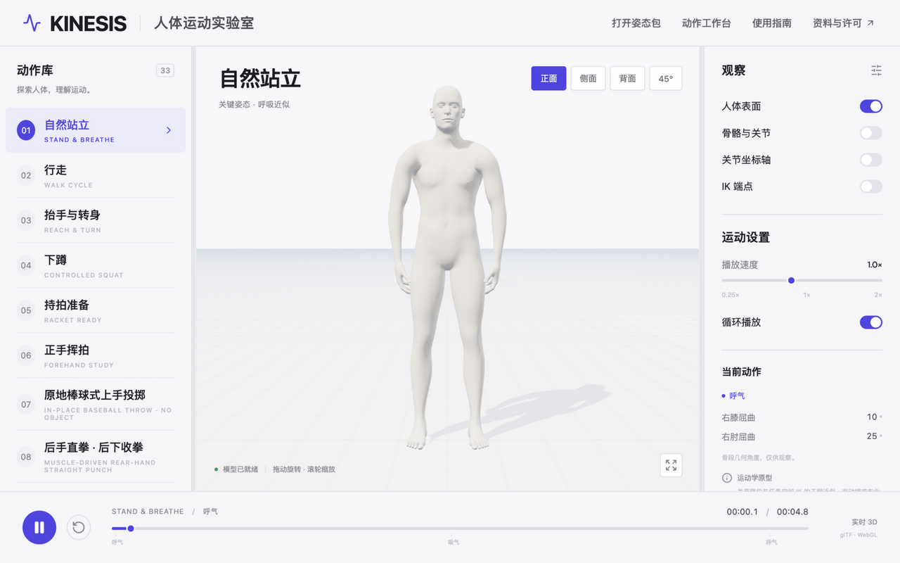
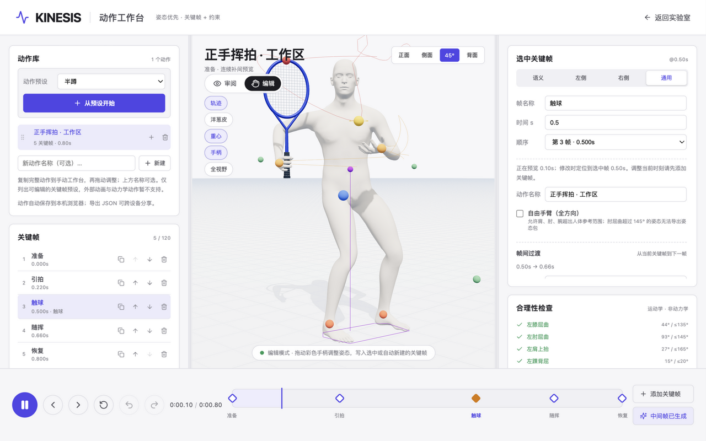
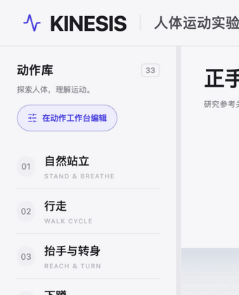
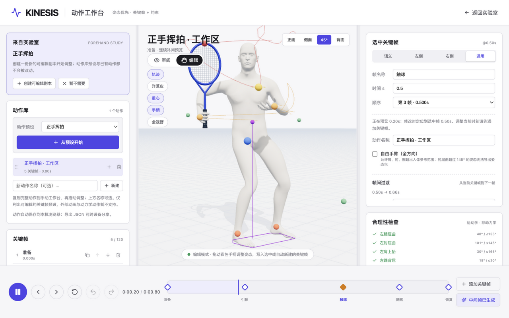
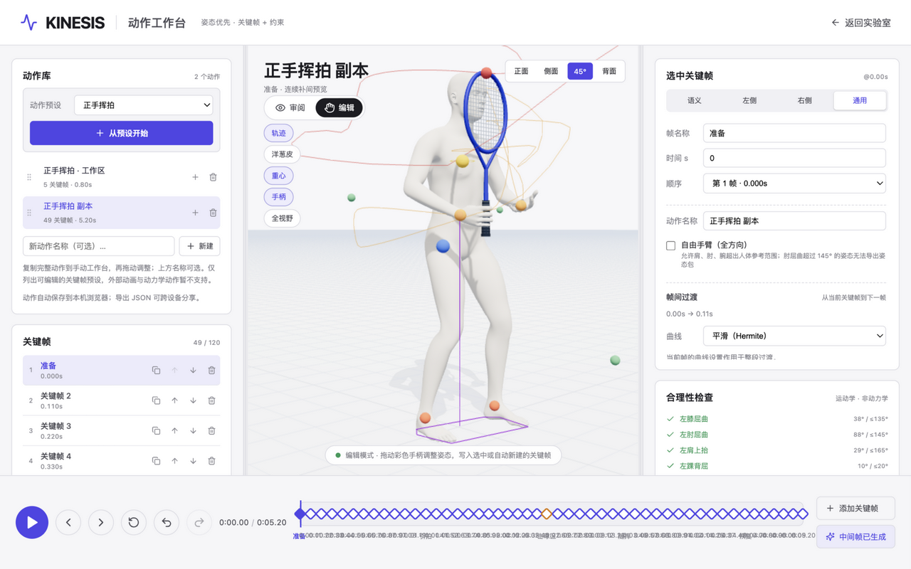
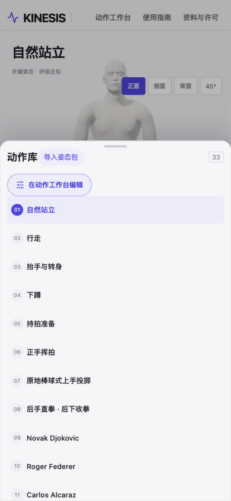
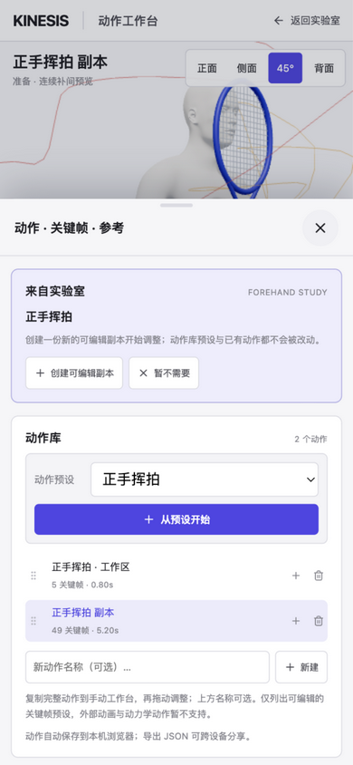
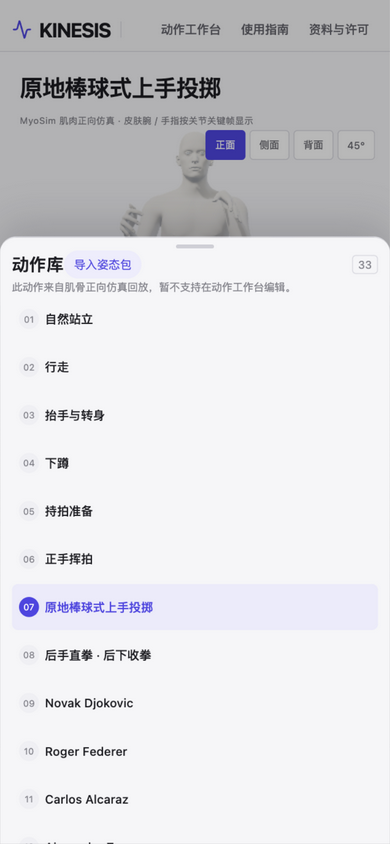

# UX Report: Lab → Workshop Motion Handoff

Date: 2026-10-24 · Branch: `feat/ux-lab-to-workshop` · Scope: `apps/web` only

## Problem

The lab (动作观察) and the workshop (动作工作台) read the same registry
(`MOTION_FILES`): every lab motion whose source is an inline workshop document
maps 1:1 by id to a workshop preset. Navigation between the two pages carried
none of that context:

- The header button 动作工作台 navigated to `/workshop.html` with no motion context.
- A user watching 正手挥拍 had to know that the workshop's 动作预设 dropdown
  (3 optgroups, 30 options) holds a matching preset, find it, and press 从预设开始.
- Nothing in the lab said which motions are editable; nothing explained why
  棒球投掷 / 直拳 (dynamics replays) and 行走 (external clip) are not.

Comparable tools converge on an explicit **duplicate-to-edit handoff**
(Spline's "remix into editor"; Microsoft's Remix 3D → Paint 3D; Sketchfab's
download-into-DCC as the non-integrated counter-example): the viewer carries
asset context into the editor, the editor offers a one-click copy, and the
source is never mutated.

## Design

One handoff parameter, two explicit affordances, zero auto-mutation:

1. **Lab** (`lab/App.tsx` + `lab/handoff.ts`): a pill button 在动作工作台编辑
   above the motion list navigates to `/workshop.html?from=<motion-id>` for
   editable motions. For non-editable ones it becomes a one-line explanation
   (dynamics replay / external clip / pose package). The header 动作工作台
   button carries `?from=` exactly when the current motion is editable.
2. **Workshop** (`workshop/WorkshopApp.tsx` + `workshop/lab-handoff.ts`): on
   entry `?from=` resolves against the registry:
   - editable preset → a 来自实验室 offer card at the top of the library panel
     (preset dropdown preselected; on phone the 动作 sheet auto-opens).
     创建可编辑副本 runs the existing `MotionLibrary.createFromPreset` flow —
     a NEW document with fresh ids; the preset and every stored document stay
     untouched. Dismissing only clears the offer.
   - known but non-editable (dynamics/clip) → an explanation card; no editable
     data is fabricated.
   - unknown/malformed id → nothing renders; the workshop opens normally.
   The URL parameter is removed (history-only) once handled, so a refresh or a
   shared link does not re-offer; the in-page offer survives refresh until
   acted on.

No protocol, schema, solver or storage changes: the handoff rides the existing
registry ids and the existing tested copy flow.

## Evidence

Before — the lab offered only the generic header button, and the workshop
ignored a handoff URL entirely:

After — explicit affordance, context-carrying navigation, one-click
duplicate-to-edit:

Mobile 390 px: the affordance sits at the top of the library drawer; entering
the workshop auto-raises the 动作 sheet with the offer; non-editable motions
explain the limitation in the drawer:

## Verification (executed)

- Unit: `apps/web/src/lab/handoff.test.ts` (4) and
  `apps/web/src/workshop/lab-handoff.test.ts` (6) — registry coverage for all
  editable ids, the three non-editable source kinds, param-less/malformed input.
- Full suite `npm test -- --maxWorkers=1`: 40 files, 671 passed, 2 skipped
  (pre-existing skips), 0 failed.
- `npx tsc -b`, `npm run build`, `npm run docs:check`, `npm run spec:check`: all pass.
- Real-browser flows (Chromium via automation, desktop 1280×800 and 390×844):
  editable handoff → create (library +1 doc, original untouched, URL cleaned);
  dismiss (no doc created); external id (explanation card); invalid id
  (no card); lab drawer explanation for a dynamics motion; header nav carries
  `?from` only for editable motions. `kinesis-workshop-library` was inspected
  before/after every mutation: the pre-existing document
  (正手挥拍 · 工作区, 5 keys) was never modified; test-created copies were
  removed and the store restored afterwards.

## Not executed / handed off

- Real-device mobile testing (emulated 390×844 only; PR #26 has the same caveat).
- `npm run qa` scripted E2E was not run; the journeys above were driven
  manually in a real browser instead.

## Rework round (review of 2026-10-24, three P2s fixed)

1. **Header nav no longer drops context for non-editable bundled motions.**
   `workshopEditability` now returns a url for every case: dynamics replays
   and external clips still forward `?from=<id>` (the workshop's external
   card explains the limitation there — it is reachable through the actual
   Lab UI now); imported pose packages keep the plain url (their ids are not
   in the registry). Verified: 行走 → header 动作工作台 → `/workshop.html?from=walk`
   renders the explanation card.
2. **The regular 从预设开始 consumes a matching handoff.** Creation is
   funnelled through one flow that reconciles the offer via
   `handoffConsumedByCreate` (new pure predicate + regression tests): when
   the created preset is the offered one, the card clears and the URL
   parameter is dropped — through either entry point, so no stale offer can
   outlive the copy it offered. Verified in-browser: card visible → click
   从预设开始 → copy created, card gone, URL clean, original doc untouched.
3. **Phone: creation closes the auto-raised sheet.** When a creation
   consumes the handoff on a compact screen, the 动作 sheet collapses so the
   3D view is visible, and the hint names the next step
   （「当前是审阅模式，点上方『编辑』即可拖动手柄修改」）— review-first default
   preserved. Verified at 390×844: after 创建可编辑副本 the sheet class is
   gone, both panels sit below the viewport, and hit-testing the stage
   center returns the canvas.

The component wiring itself is not unit-testable without rendering the app
(this repo tests pure logic only), so the three interactions are verified in
the real browser as above; the extracted predicate carries the regression
tests the review asked for.

## Follow-up candidates

- Round-trip: workshop 返回实验室 could restore the last-viewed lab motion.
- Offer card could link straight to an existing library document when the user
  already duplicated that preset in this browser (needs a provenance map
  outside `WorkshopDoc`).
- The lab affordance is a 38 px-tall pill on phones — fine next to the
  adjacent 导入姿态包 pill, but worth revisiting if touch-target audits come up.
